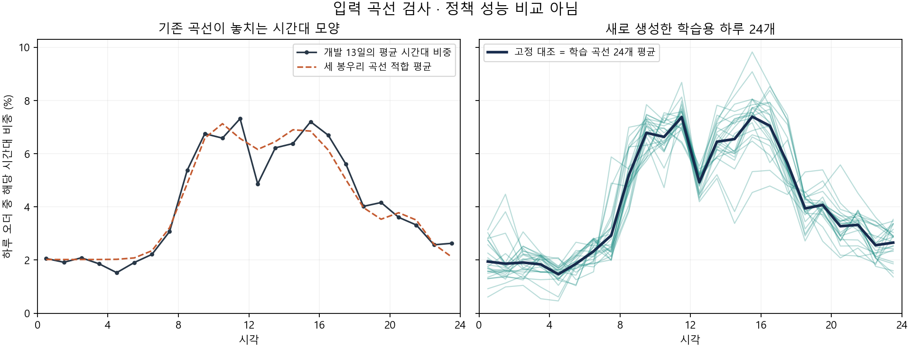

# 날짜별 합성 곡선 구현·입력 검사 — YR-332-ao

2026-11-15. **변동 곡선과 조건부 입력 은행을 구현했다. 신경망 교체·새 학습·정책 성능 평가는 하지 않았다.**

## ① 진행사항

1. 이미 본 13일의 오더별 시간대 집계로 곡선을 맞췄다. 트럭 방문 수와 구분했다.
2. 기존 세 봉우리+기저 비중만 바꾸는 방식은 13일 모두 표현 기준에 실패했다.
3. 시간대 높이를 연결하는 주기적 선형 곡선을 입력 자료만으로 비교해 1시간 간격을 선택했다.
4. 두 적합 곡선의 계수를 보간하여 학습 24개·선택 6개·잠금 6개의 새 곡선을 생성했다.
5. 고정 대조 곡선은 학습용 24개 곡선의 점별 평균이다. 선택/잠금 곡선은 평균에 사용하지 않았다.

| 곡선 가족 | 표현 기준 통과 날짜 | 시간대 비중 잔차 |
|---|---:|---:|
| original_gaussians | 0/13 | 4.344~13.493%p |
| periodic_linear_6 | 0/13 | 5.901~10.300%p |
| periodic_linear_8 | 0/13 | 4.960~10.136%p |
| periodic_linear_12 | 3/13 | 3.472~7.944%p |
| periodic_linear_24 | 13/13 | 0.000~0.044%p |

잔차는 실제 집계의 시간대 비중을 곡선 비중으로 맞추기 위해 옮겨야 하는 비중의 합이다.
낮을수록 시간대 모양이 가깝다. 통과는 같은 자료를 표현할 수 있다는 뜻이며 새 날짜 예측의 검증이 아니다.
24개 시간대 자료에 24개 계수를 맞췄으므로 작은 잔차를 모델의 일반화 성능으로 해석하지 않는다.

## 입력·재현 검사

- 3개 물량 × 3개 곡선 × 고정/변동 = **18개** 입력을 검사했다. 동일 입력 1회 반복도 정확히 일치했다.
- 총 오더 수·작업 종류·블록·컨테이너 대상·초기 재고·선박 계획을 대조군과 대조했다.
- 전건 예약·시각 범위·통지 선후관계·방문 용량·반입 후 반출 제약을 검사했다.
- 곡선 난수와 기존 사건 난수를 분리했다. 분할별 최종 시드 36개와 곡선 해시에 중복이 없다.
- 관련 시험 37건 통과. 이후 준비 절차 추가 뒤 곡선/입력 시험 15건을 다시 통과했다.

## 발견한 입력 결함과 처리

처음의 seed=9934102·15,000건은 반출 대상 부족 때문에 반출 44건이 반입으로 바뀌었다.
곡선 변경 전에도 있는 동작이다. 요청한 종류가 유지되지 않아 이 시드를 그대로 사용하지 않았다.
모든 곡선은 유지하고, 정책 실행 전에 3개 부하에서 작업 종류가 유지되는 배경만 생성했다.

- 배경 후보 **41개** 중 **5개**를 거절하고 **36개**를 확정했다.
- 거절된 후보들에서 작업 종류가 바뀌는 건수 합은 **734건**이다.
- 재시도는 미리 정한 시드 간격 1,000이며 모든 거절 시드·블록·물량·건수를 저장했다.
- 거절 기준은 재고 부족에 의한 작업 종류 변경뿐이다. 유효한 혼잡 입력이나 나쁜 정책 결과를 버리지 않았다.
- 공급 생성기의 근본 문제는 at로 등록했다. 이번 입력 은행은 **재고가 성립하는 조건부 상황**이다.

최초 감사에서 반출 크기를 반입용 무작위 규격 필드로 잘못 읽는 감사 코드 오류도 수정했다.
반출은 실제 대상 컨테이너 크기로 검사한다. 환경의 방문·물리 구현을 고친 것은 아니다.

## ② 해석·판정·한계

- 입력 계약·재현 검사: 통과. 코드가 기본 입력을 조용히 바꾸지 않으며 선택한 은행을 명시적으로 넣는다.
- 시드 현실 타당성 전체: **미통과 유지**. 운반/대기열 근거와 전역 공급 문제가 남아 있다.
- 정책 성능: 이번에는 미평가. 이전 모델의 실패를 뒤집는 증거가 아니다.
- 이것은 **집계 통계로 보정한 합성 입력**이다. 원본 오더를 그대로 재생하지 않지만 통계 사용 사실을 숨길 수 없다.
- 시간대 안 분별 방문 형판은 현재 방식을 유지한다. 수식만으로 만든 전체 도착 입력은 아직 아니며 ar에서 분리 교체한다.
- 두 곡선의 보간은 변동을 줄인다. 생성 일별 산포가 관측과 같다고 주장하지 않는다.
- 13일은 모두 개발 자료다. 잠금 6개는 새로운 합성 조건이지 미사용 실제 기간이 아니다.
- 7,500/15,000건은 부담 시험이다. 실제 터미널 전체 물량의 대표성 근거로 쓰지 않는다.

## ③ 예정사항 — 등록된 작업

- ao: 이 곡선 은행의 고정 정책 민감도를 사전 고정해 확인하고 반출 비율 변화는 별도 축으로 검토한다.
- at: 요청한 반출 종류를 보존하는 재고·본선 공급 생성을 고쳐 조건부 시드 선택의 필요를 줄인다.
- ar: 시간대 안 관측 형판을 수식 기반 방문 도착으로 교체해 별도 검증한다.
- 323-d: 같은 망에서 표본·갱신·이전 회차 정답 재사용을 한 축씩 진단한다. as는 관계망/학습법 비교 설계다.

## 근거·재현

- [원래 가족 실패](calibration-original_gaussians.json), [선택 가족 입력 적합](calibration-periodic_linear_24.json)
- [확정 곡선·시드 은행](bank-ready.json), [배경 거절·채택 원장](scenario-preflight.json), [입력 감사](input-audit.json)
- [집계](summary.json), [입력 수정 이력·기준](../../../docs/research/v7-discharge/day-shape-prereg.md)
- 실행: `audit_day_shapes.py calibrate --knots 24` → `prepare-scenarios` → `inputs`.
  `--knots` 생략은 원래 가족 진단이다. 기존 값은 수정하지 않고 가족별 별도 파일로 남긴다.
- 읽기 전용 신경망 근거: [검토](../../../docs/research/v7-discharge/network-learning-review.md).
