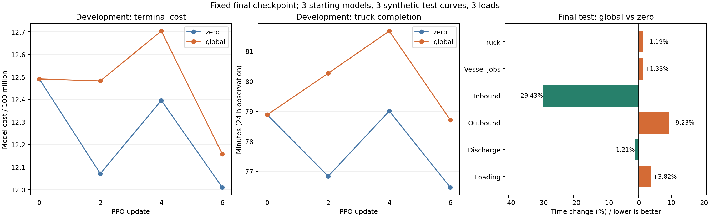

# 전역 대기 정보의 정책 성능 비교

**전역 대기 정보를 추가한 최종 모델의 총비용 변화는 +0.26%다.**
비교 기준은 같은 입력·시작 모델·학습량을 사용한 전역 정보 없는 모델이다. 낮을수록 좋다.
예측 오차의 악화 여부와 관계없이 정해진 학습·평가를 끝냈다. 기본 정책 채택이나 실제 항만 효과를 뜻하지 않는다.

## ① 진행사항

- 원본 시각이 확인된 자료로 만든 같은 보정값을 양쪽 조건과 규칙에 적용했다.
- 새 합성곡선은 학습 12개·개발 3개·최종 시험 3개이며 연결 검사 1개는 학습에서 제외했다.
- 기존 정규화 모델 3개를 각각 복제해 총 6개를 학습했다. 새 입력 칸의 가중치는 0, Adam 갱신기는 새로 시작했다.
- 두 조건의 차이는 비용 예측망에 주는 21개 블록의 작업 시작 대기 외부 트럭 오더 합계 하나다.
- 작업 선택 Transformer 입력 10개·모든 실행 가능 후보·총비용·보상 기간·물리 제약은 유지했다.
- 모델당 12합성일·6회 갱신, 매회 2,048개 경험을 4번 학습했다. 전체 선택 경험 73,728개·가중치 갱신 4,608번이다.
- 초기·2·4·6회 갱신 모델을 개발 입력에서 기록하고, 마지막 6회 모델만 최종 시험했다.
- 최종 시험은 새 곡선 3개 × 물량 3수준이다. 총 180평가 중 운영 비교 153회와 별도 예측 진단 27회를 구분했다.
- 동일 입력 평가 2회를 재실행했고, 저장 경험으로 6개 모델의 총 36회 갱신을 다시 계산했다.
- 관련 시험 19건, 학습 장부 624,000오더·평가 장부 1,575,000오더를 확인했다.

| 지표 | 추가 학습 전 | 전역 정보 없음 | 전역 정보 있음 | 짧은 실작업 우선 규칙 | 전역 추가 변화 |
|---|---:|---:|---:|---:|---:|
| 평균 트럭(분) | 74.935 | 73.251 | 74.124 | 57.790 | +1.19% |
| 평균 본선 작업(분) | 768.837 | 756.041 | 766.064 | 700.085 | +1.33% |
| 반입(분) | 22.554 | 34.728 | 24.507 | 17.568 | -29.43% |
| 반출(분) | 116.048 | 103.506 | 113.056 | 89.339 | +9.23% |
| 양하(분) | 743.822 | 750.277 | 741.212 | 721.606 | -1.21% |
| 적하(분) | 793.852 | 761.805 | 790.916 | 678.565 | +3.82% |

트럭은 오더당 게이트 진입→작업완료다. 본선은 계획된 작업 묶음 시작→개별 야드 작업완료다.
본선 수치는 선박 전체의 입항→출항 시간이 아니다. 출차를 늦춘 시간은 트럭 작업시간에 넣지 않는다.
24시간 관측 종료 때 미완료인 작업도 그때까지의 경과시간으로 평균에 포함한다. 전건의 최종 완료시간을 관측한 평균은 아니다.
주 평균은 합성곡선·물량·모델에 같은 비중을 준다. 오더 수 가중 평균은 summary.json에 별도로 보존했다.

| 조건 | 총비용: 전역 정보 없음 대비 | 본선 지연비용: 전역 정보 없음 대비 | 26시간 뒤 미완료(건/실행) |
|---|---:|---:|---:|
| 추가 학습 전 | +2.86% | +3.01% | 2466.074 |
| 전역 정보 없음 | +0.00% | +0.00% | 2225.519 |
| 전역 정보 있음 | +0.26% | +2.35% | 2354.519 |
| 짧은 실작업 우선 규칙 | -24.56% | -11.05% | 1520.111 |

총비용은 기존 연구 목적함수의 환산 비용이다. 실제 터미널 회계 청구액으로 주장하지 않는다.

| 작업 | 전역 정보 없음: 24시간 / 26시간 미완료 | 전역 정보 있음: 24시간 / 26시간 미완료 |
|---|---:|---:|
| 평균 트럭 | 1175.222 / 838.704 | 1186.370 / 899.963 |
| 평균 본선 작업 | 1572.296 / 1386.815 | 1633.889 / 1454.556 |
| 반입 | 165.370 / 43.852 | 53.519 / 0.037 |
| 반출 | 1009.852 / 794.852 | 1132.852 / 899.926 |
| 양하 | 778.741 / 692.148 | 759.852 / 673.778 |
| 적하 | 793.556 / 694.667 | 874.037 / 780.778 |

위 건수는 실행당 평균이다. 24시간 이후 2시간의 마무리 실행에서 얼마나 남는지도 함께 본다.

| 시작 모델 | 총비용 변화 | 트럭 시간 변화 | 본선 작업시간 변화 |
|---|---:|---:|---:|
| 9951101 | +6.77% | +7.42% | +2.51% |
| 9951102 | -4.75% | -3.14% | +2.88% |
| 9951103 | -0.79% | -0.09% | -1.22% |

| 하루 물량 | 총비용 변화 | 반입 | 반출 | 양하 | 적하 |
|---|---:|---:|---:|---:|---:|
| 3,500 | +10.23% | +1.51% | +11.08% | -1.67% | +9.82% |
| 7,500 | +6.17% | +6.17% | +6.96% | -1.76% | +2.86% |
| 15,000 | -0.64% | -40.41% | +9.46% | -0.41% | +0.55% |

모델별·물량별 결과도 고정된 마지막 모델끼리 비교했다. 양수는 악화, 음수는 감소다.

| 예측 진단 범위 | 추가 학습 전 | 전역 정보 없음 | 전역 정보 있음 |
|---|---:|---:|---:|
| 전체 | 2.177437 | 1.745664 | 1.777516 |
| 3500건 | 2.381554 | 1.449719 | 1.584628 |
| 7500건 | 1.900366 | 1.858795 | 1.789536 |
| 15000건 | 2.222727 | 1.893469 | 1.940413 |
| 00~06시 | 3.105875 | 2.646731 | 2.610736 |
| 06~12시 | 2.490191 | 2.071314 | 2.063467 |
| 12~18시 | 1.761311 | 1.477644 | 1.509727 |
| 18~24시 | 1.869933 | 1.112417 | 1.238006 |

예측 오차는 RMSE(큰 오차에 더 무게를 준 평균 오차)이며 단위는 기존 고정 보상 눈금이다.
정책별로 방문한 상태가 달라 예측 오차 차이를 전역 정보의 순수한 예측 효과로 해석하지 않는다.
오차는 중단 기준으로 쓰지 않았다. 학습 표본의 갱신 전후·물량/시간대별 기록도 audit.json과 원파일에 남겼다.

## ② 해석

- 전역 추가의 총비용 변화 +0.26%, 트럭 +1.19%, 본선 작업 +1.33%다.
- 짧은 실작업 우선 규칙 대비 전역 모델의 총비용은 +32.90%, 트럭은 +28.26%다.
- 추가 학습 전 대비 총비용: 전역 없음 -2.78%, 전역 있음 -2.53%다.
- 전역 추가 총비용 변화의 탐색용 95% 구간은 [-4.57%, +6.67%]다.
- 물량을 먼저 평균한 뒤 곡선 3개와 시작 모델 3개를 각각 복원 추출해 10,000번 계산했다. 작은 합성 표본의 불확실성이다.
- 작업별 보호·규칙 비교·완주를 함께 보는 채택 수치 조건: 미충족.
- 예측 오차 한계 때문에 멈춘 이전 실험과 달리 실제 정책까지 비교했다. 탐색 완주와 성능 성공은 구분한다.
- 새 곡선도 같은 13개 날짜의 보정값과 같은 생성법을 쓴다. 실제 운영일을 따로 검증한 시험은 아니다.
- 7,500·15,000건은 실측 범위 밖 부하 시험이다. 운반 흐름·대기열·고물량 몰림의 현실성은 여전히 미확인이다.
- 저장 경험의 갱신은 정확히 재현했다. 전체 학습 환경 궤적 72일을 모두 다시 실행한 것은 아니다.
- 기본 정책은 변경하지 않는다. 이번 결과만으로 실제 항만에서의 효과나 최적해를 입증하지 않는다.

## ③ 예정사항

- YR-332-i(운반 흐름 확인): 운반 장비의 투입·주행·인계 자료로 본선 작업의 시간과 용량을 확인한다. 외부 자료 대기다.
- YR-332-f(대기열 정의 확인): 관측된 대기 수가 오더인지 차량인지, 어느 단계인지 확인한다. 혼잡 지표를 현실과 연결하려면 필요하다.
- YR-332-ap(고물량 몰림 확인): 바쁜 날의 실측 자료로 높은 부하의 도착 몰림을 판정한다. 현재 두 높은 물량은 민감도 시험으로 남긴다.

[실행 계약](../../../docs/research/v7-discharge/global-policy-prereg.md) · [전체 수치](summary.json) · [독립 검산](verification.json) · [재현 방법](REPRODUCE.md)

