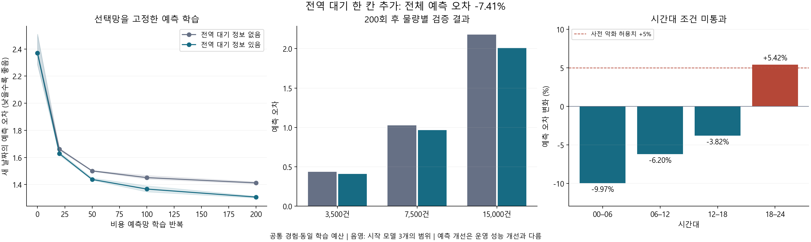

# 전역 대기 정보의 비용 예측·조건부 정책 비교

**새 날짜의 예측 오차 -7.41%, 사전 예측 기준 미통과.**
전역 대기량은 비용 예측망에만 넣었다. Transformer의 작업 선택 입력·총비용·보상창은 유지했다.

## ① 진행사항

- 고정 행동 정책으로 학습 12일·검증 9입력의 공통 경험 30,720개를 모았다.
- 이전 정규화 모델 3개의 공유 표현·선택망은 고정하고, 비용 예측 부분만 같은 예산으로 200회 반복했다.
- 두 군의 차이는 21블록 대기 외부 트럭 오더 합계 한 칸이다. 대조군은 같은 칸에 0을 넣었다.
- 3,500건 동작 시험에서 기록만 추가한 실행의 후보·행동·사건·비용·난수 흐름이 정확히 같았다.
- 관련 검사 20건, 예측 학습 6개 재실행, 공통 경험 1회 재실행과 원장 재계산을 확인했다.
- 트럭 182,000오더와 전역 대기 기록을 대조했고, 저장 모델의 예측값도 정확히 재생됐다.

| 검증 물량 | 전역 정보 없음 | 전역 정보 있음 | 예측 오차 변화 |
|---|---:|---:|---:|
| 전체 | 1.412691 | 1.307982 | -7.41% |
| 3,500건 | 0.435585 | 0.409672 | -5.95% |
| 7,500건 | 1.026266 | 0.964569 | -6.01% |
| 15,000건 | 2.178102 | 2.008537 | -7.78% |

오차는 RMSE(큰 오차를 더 크게 반영한 평균 예측 오차)다. 낮을수록 좋다.
단위는 고정 보상 눈금이며 분·원화 청구액이 아니다. 날짜와 모델에 같은 무게를 줬다.

| 시간대 | 전역 정보 없음 | 전역 정보 있음 | 예측 오차 변화 |
|---|---:|---:|---:|
| 00–06시 | 2.940290 | 2.647279 | -9.97% |
| 06–12시 | 1.986583 | 1.863493 | -6.20% |
| 12–18시 | 0.707911 | 0.680885 | -3.82% |
| 18–24시 | 0.376207 | 0.396584 | +5.42% |

| 시작 모델 | 예측 오차 변화 |
|---|---:|
| 9951101 | -7.48% |
| 9951102 | -6.92% |
| 9951103 | -7.82% |

### 조건을 바꾸지 않고 판정했는가

- 전체 오차 5% 이상 감소·모델 3쌍 모두 감소·물량별 악화 2% 이하·시간대별 악화 5% 이하를 미리 정했다.
- 0/20/50/100/200회 곡선을 보존했고 마지막 200회만 판정했다. 유리한 회차를 골라 쓰지 않았다.
- 전체 오차5% 감소: 통과, 세 모델 모두 감소: 통과, 물량별 악화 제한: 통과, 시간대별 악화 제한: 미통과, 선택망 고정: 통과, 관측 시각·행동 불변: 통과.

## ② 해석

- 사전 예측 기준을 모두 만족하지 못해 PPO 재학습과 새 정책 성능 비교로 확대하지 않았다.
- 18~24시 오차는 0.376207→0.396584로 5.42% 증가했다. 허용치 5%를 0.42%p 넘었다.
- 다른 시간대·세 물량·세 시작 모델의 전체 평균에서는 감소했다. 마지막 시간대는 세 모델 모두 늘었다.
- 다만 이 경계 차이를 근거로 기준을 완화하거나 유리한 중간 모델을 골라 다음 실험으로 넘기지 않았다.
- 5%는 추가 정책 실험 여부를 위한 실용적 기준이다. 마지막 시간대의 악화가 통계적으로 확정됐다는 뜻은 아니다.
- 이번에는 작업 선택을 고정했다. 따라서 예측 오차 변화는 트럭·본선 작업시간의 개선율이 아니다.
- 이 한 대기 요약·고정 행동 정책·학습 예산에서의 결과다. 모든 전역 정보가 쓸모없다는 결론은 아니다.

- 24시간 전 결정에서 읽은 관측의 지연: 평균 9.14초, 95%가 32.13초 이내, 최대 59.99초.
- 대기 오더는 0~4,090개, 변환한 입력은 0.0000~1.5540였다. 입력 상한은 자르지 않았다.
- 24시간 뒤 배수 구간은 마지막 관측을 유지하여 최대7199.72초 오래된 값이다. 이 구간은 학습 표본에서 제외했다.
- 같은 시각의 review·도착·작업시작은 기존 사건 순서를 따른다. 뒤에 처리되는 동시각 사건을 사후 입력하지 않았다.
- 검증은 새 합성곡선3개를 물량3수준에 적용한9입력이다. 9개의 독립 실제 운영 기간이 아니다.
- 새 곡선도 이전과 같은 생성법·보정 근거를 쓴다. 고물량7,500/15,000건은 실제 고물량 재현이 아닌 부하 시험이다.
- 운반 흐름·대기열 정의의 실측 확인이 남아 현실성은 미통과다. 현장 성능을 주장하지 않는다.

## ③ 예정사항

- YR-332-i: 운반 장비의 투입·주행·인계 자료를 확인한다. 본선 작업의 시간·용량을 실제 흐름에 맞춰 판단하기 위해 필요하다.
- YR-332-f: 블록 대기열의 관측 단위를 확인한다. 대기 오더 수와 실제 차량 대수를 혼동하지 않기 위해 필요하다.
- 두 작업 모두 외부 자료 대기 상태다. 이번 진단으로 그 선결을 해소했다고 하지 않는다.

[실행 사전등록](../../../docs/research/v7-discharge/global-value-context-prereg.md) · [수치](summary.json) · [검산](verification.json) · [재현 방법](REPRODUCE.md)

문헌 근거: [MAPPO](https://arxiv.org/abs/2103.01955)의 전역 학습 정보 활용과
[중앙 평가자 분석](https://arxiv.org/abs/2408.14597)의 효과·편향·분산 한계를 함께 고려했다.
