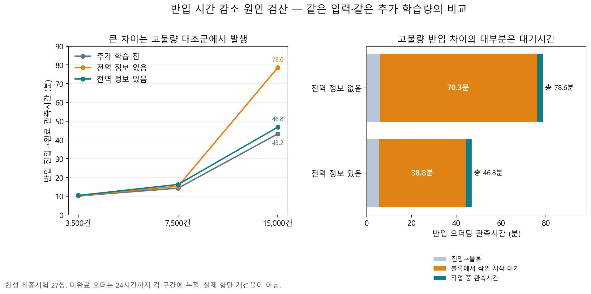

# 반입 시간 감소를 실제 기록과 대조한 결과

**합성 실험의 반입 차이는 주로 작업 시작 전 대기 감소였다. 실제 기록에서도 반입이 짧지만, 29.43% 개선의 현장 재현은 확인되지 않았다.**
2026-11-20 · YR-332-bd(반입 시간 감소의 실제 기록·정책 선택 대조).
원본과 기존 모델을 읽어 분석했다. 새 정책 학습·시뮬레이션 실행·환경 보정은 하지 않았다.

## ① 진행사항

### 먼저 비교 기준을 바로 읽는다

| 하루 오더 | 추가 학습 전 반입(분) | 전역 정보 없음(분) | 전역 정보 있음(분) | 전역 있음/없음 변화 |
|---|---:|---:|---:|---:|
| 3,500 | 10.13 | 10.27 | 10.42 | +1.51% |
| 7,500 | 14.31 | 15.32 | 16.27 | +6.17% |
| 15,000 | 43.23 | 78.60 | 46.83 | −40.41% |
| 세 물량 동일 비중 | 22.55 | 34.73 | 24.51 | −29.43% |

큰 감소는 고물량에서 전역 없는 모델의 반입 시간이 늘어난 데서 발생했다.
추가 학습 전 대비 반입은 전역 없음+53.98%, 전역 있음+8.66%다. 처음보다 반입이 빨라졌다는 결과는 아니다.
각 모델의 전체 비용은 추가 학습 전보다 줄었으므로, 특정 작업 변화와 전체 목적함수 변화를 구분한다.

### 같은 오더를 구간별로 다시 계산했다

아래 평균은 모든 오더를 포함한다. 아직 다음 단계에 이르지 못한 오더는24시간까지 해당 구간에 누적한다.
세 구간의 합은 기존 보고서의 진입→작업완료 평균과 일치한다.

| 반입 구간 | 전역 정보 없음(분) | 전역 정보 있음(분) | 변화(분) |
|---|---:|---:|---:|
| 게이트 진입→블록 도착 | 5.33 | 5.21 | −0.12 |
| 블록 도착→작업 시작 | 26.88 | 16.74 | −10.14 |
| 작업 시작→완료 관측 | 2.52 | 2.56 | +0.04 |
| 합계 | 34.73 | 24.51 | −10.22 |

반입 시간 차이의99.20%가 블록에서 작업 시작을 기다리는 구간의 감소다.
완료된 오더만 따로 잰 실제 모형 작업시간도2.589→2.584분으로 거의 같았다.
반출은 블록 대기가85.40→96.92분으로 늘었다. 고물량에서는 반입 대기70.32→38.81분,
반출 대기215.33→244.65분이다. 짧은 작업에 기회가 더 배분됐다는 해석을 지지한다.

모든27쌍에서 오더·유형·최초 블록·예약·통지·주행값·게이트 진입시각이 같은 것을 확인했다.
게이트→블록 간격은 순수 주행만이 아니다. 여러 작업을 하는 방문의 앞 작업 대기·완료에 따라 달라질 수 있다.
두 모델 모두24시간 안에 완료한 공통 반입만 비교해도33.30→24.57분이다.
따라서 미완료를 포함한 집계만으로 생긴 차이는 아니다. 다만 완료 표본만의 분석에는 선택 편향이 있다.

### 동일 후보에 모델을 적용했다

저장 검증 경험55,296개를 읽고, 크레인 하나가 반입·반출 중 고를 수 있는21,989개 상태를 비교했다.
같은 초기값의 초기 모델과 전역 없음/있음 모델을 같은 후보·합법 선택 목록에 적용했다.

| 반입이 최고점인 상태 비율 | 추가 학습 전 | 전역 정보 없음 | 전역 정보 있음 |
|---|---:|---:|---:|
| 전체 공통 상태 | 89.92% | 62.99% | 78.47% |
| 15,000건 상태14,382개 | 95.69% | 63.61% | 89.81% |

초기 모델에 강한 반입 선호가 있었고, 전역 없는 모델에서 그 선호가 더 크게 줄었다.
전체 평균에서 전역 모델이 반입을 더 우선하지만 세 시작 모델 모두 같은 방향은 아니다.
3개 중2개에서 전역 모델의 반입 최고점 비율이 더 높고, 나머지1개는100%→94.12%로 낮다.
초기/전역 없음/전역 있음 정책의 경험을 각각 따로 집계해도 두 최종 모델의 전체 차이는 같은 방향이다.

이 상태에서 모형이 예상하는 후보 작업시간은 반입2.56분·반출6.22분,
재취급(대상 위 컨테이너를 먼저 옮기는 작업)은 반입0회·반출1.82회다.
상태의98.41%에서 반입 후보의 평균 작업시간이 더 짧았다.
코드도 반입은 빈 장치 위치로 한 번 옮기고, 반출은 대상 위의 컨테이너를 먼저 옮긴 뒤 꺼내도록 구현돼 있다.
저장 후보의 순위 비교는 개별 선택이 낳은 비용의 인과 분리나 실제 항만 선택 기록은 아니다.
전체 수치는 상태 수 기준이며, 비용 보고서의 날짜·모델 동일 가중 평균과 집계 단위가 다르다.

### 실제 원본13일의 같은 구간과 대조했다

원본600파일이 기존 해시와 같은지 확인했다. 게이트 진입 시각이 명시된33,703건을 기준으로,
진입·블록 도착·작업 완료가 모두 원본 메시지 시각과 연결되고 시간 순서가 맞는 표본을 분석했다.
차량 방문 전체가 아닌 컨테이너 오더 단위이며, 누락된 사건 시각은 채우지 않았다.

| 실제 기록 | 반입 | 반출 |
|---|---:|---:|
| 진입 시각이 확인된 오더 | 15,620건 | 18,083건 |
| 세 시각이 모두 확인된 표본 | 6,358건 | 12,074건 |
| 위 표본의 포함 비율 | 40.70% | 66.77% |
| 진입→완료 중앙값 | 16.08분 | 25.53분 |
| 블록 도착→완료 중앙값 | 10.23분 | 18.63분 |
| 진입→완료 평균 | 20.67분 | 31.33분 |

관측 가능한 표본에서는 실제 반입도 반출보다 짧았다. 날짜별로 나눈13개 날짜 모두 중앙값의 방향이 같았다.
출차까지 사건 순서를 추가 확인한 표본에서도 진입→완료 중앙값은16.10분·25.51분으로 방향이 유지됐다.
기본 표본 중 완료보다 출차가 빠른 기록은 반입60건·반출1건이며, 원본 연결·운영 의미의 추가 확인 대상이다.
전체 자료의 종료·누락 때문에 실제 미완료인지 기록 누락인지 판정할 수 없는 오더는0분으로 취급하지 않았다.

**실제 CSV의 `work_min`은 블록 도착→완료이며 대기와 작업을 합친 값이다.**
`wait_min`은 게이트→블록 구간이다. 전수 계산에서 원본 시각 차이와0.1분 반올림 범위 안에서 일치했다.
두 열을 각각 모형의 순수 작업시간·블록 대기시간으로 사용하면 서로 다른 구간을 맞추게 된다.
작업 시작 시각 필드는 없고, 원본의 재취급 횟수도 채워진 값이 없었다.
따라서 모형의2.56분 대6.22분, 재취급0회 대1.82회가 실제와 맞는지는 아직 검증할 수 없다.

## ② 해석

확인된 것은 **모형의 짧은 반입 작업, 고물량에서의 선택 우선순위 차이, 반입 대기 감소**다.
전역 모델이 대조 모델보다 반입을 더 먼저 선택하는 경향과 시간 분해가 맞아떨어진다.
다만 비용 예측 손실과 공유 Transformer 표현 중 어느 변화가 이 선택을 만들었는지 인과적으로 분리한 것은 아니다.
전역 대기 정보는 비용 예측망에만 들어갔고 작업 선택망의 직접 입력은 그대로다.
두 망이 공유하는 표현과 학습 결과가 달라진 상황이므로, 전역 정보를 보고 즉시 반입을 고른 실험으로 설명하지 않는다.

실제 기록은 반입이 짧다는 방향을 뒷받침한다. 표본 누락률과 작업 시작 정보 부재 때문에
반입 선호의 크기나29.43%의 현장 효과까지 입증하지는 못한다.
3,500/7,500건에서는 반입도 소폭 악화했고, 가장 큰 이득이 난15,000건은 실측 범위 밖 부하 시험이다.

공식 자료의 장비·방문 절차도 확인했다.

- [HJNC 터미널 특징](https://www.hjnc.co.kr/terminal/feature)은21블록·42기 크레인과 수평 야드를 설명한다.
- [DGT 장비 소개](https://info.dgtbusan.com/DGT/terminal/equipment)는 블록당 두 크레인의 육측·해측 분리를 설명한다.
  DGT의 자료와 HJNC 형태 합성 모형을 한 터미널의 동일 운영 구조로 해석하지 않는다.
- [DGT 복화 운영 안내](https://www.dgtbusan.com/DGT/esvc/board/notice/detail?bIdx=441)는 두 작업 순서를 모두 안내한다.
  현재 모형의 반입 먼저 규칙은 기존 표본의 지배적 순서에 근거한 제한이며 모든 현장의 필수 절차는 아니다.
  두 모델이 같은 규칙을 썼으므로 그 규칙을 이번 차이의 독립 원인으로 확정하지 않는다.

판정: 성능은 기존bc의 일관된 개선 미확인·채택 미달을 유지한다. 분석 수치·원본 불변은 검증했다.
현실성은 작업 시작·재취급·운반·고물량 근거가 남아 미확인이다. 모형·보상·기본 정책을 바꾸지 않았다.

## ③ 예정사항

- **YR-332-f(대기열 정의 확인)**에 이번 구간 검산을 연결했다. 실제 작업 시작과 재취급 횟수를 확인해야
  모형의 반입·반출 서비스시간 차이와 순수 대기시간을 따로 검증할 수 있다. 외부 자료 대기 상태다.
- **YR-332-ap(고물량 몰림 확인)**는 바쁜 날의 실제 자료로15,000건 조건을 검증하는 작업이다.
  이번 반입 이득이 그 조건에 집중돼 있으므로 현장 효과 해석에 필요하다. 외부 자료 대기 상태다.
- **YR-332-i(운반 흐름 확인)**의 장비별 운반 단계 확인도 기존대로 남는다.

## 검산과 재현

독립 흐름 원장에서780,000개 트럭 오더의24/26시간 평균·미완료를 재계산했다.
실제18,432개 세 시각 표본의 평균·중앙값을 별도 계산했고, 저장 모델·경험과 원본600파일 불변을 확인했다.
55,296개 상태의 선택 분석에서 물량별·모델별 합계가 전체 집계와 맞는지도 검사했다.
새 학습이나 환경 재실행을 한 검증은 아니다. 분석 코드 기본 commit은821f80a8이다.

```powershell
$env:PYTHONPATH='src;scripts/v7'
..\yr331-env\Scripts\python.exe scripts/v7/inbound_realism_sim.py
..\yr331-env\Scripts\python.exe scripts/v7/inbound_realism_records.py
..\yr331-env\Scripts\python.exe scripts/v7/inbound_realism_choices.py
..\yr331-env\Scripts\python.exe scripts/v7/verify_inbound_realism.py
```

그림은 Matplotlib이 있는 별도 환경에서 `python scripts/v7/plot_inbound_realism.py`로 생성한다.
[구간 원값](simulation.json) · [실제 기록 집계](real-records.json) · [같은 후보의 선택](choices.json) ·
[독립 검산](verification.json) · [공식 출처](official-sources.json).


