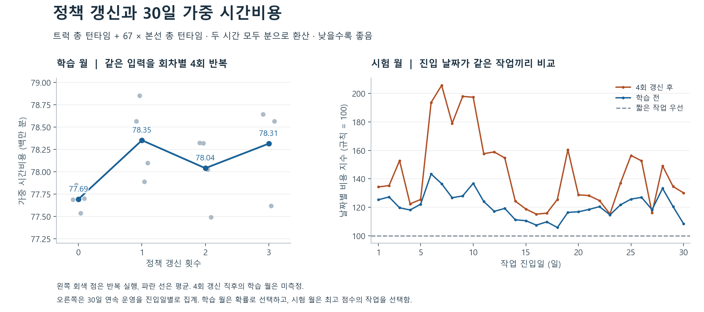

# 1대67 보상 재학습과 처음 보는 한 달 비교

합성 환경 탐색이다. 현실성 판정은 미통과로 보존돼 있고 현장 성능이나 정책 채택을 뜻하지 않는다.

**판정: 미달: 새 모델이 짧은 작업 우선보다 두 평균 모두 길다.**

새 모델은 기존 모델과 비교해 트럭 +33.69분/작업, 본선 +6.97시간/척, 가중 합계 +23.07%였다.

## 시험 월 (학습에 쓰지 않은 30일)

| 방식 | 트럭 분/작업 | 본선 시간/척 | 1대67 가중 합계(백만 분) | 규칙 대비 | 느린 트럭 5% 경계(분) | 안전운임 환산(억원) |
|---|---:|---:|---:|---:|---:|---:|
| 새 모델(1대67 보상) | 154.70 | 50.46 | 51.624 | +51.52% | 896.54 | 171.75 |
| 기존 모델 | 121.01 | 43.49 | 41.948 | +23.12% | 733.41 | 126.87 |
| 짧은 작업 우선 | 94.19 | 37.49 | 34.070 | +0.00% | 548.45 | 89.82 |
| 오래 기다린 작업 우선 | 150.47 | 48.06 | 49.815 | +46.21% | 699.59 | 161.71 |

트럭 206,500건과 본선 97척이 네 방식 모두에서 끝났는지와 진입 시각이 같은지를 원장에서 확인했다. 가중 합계는 낮을수록 좋다.

## 짧은 작업 우선과의 차이 (날짜 단위 재표집, 탐색용 95% 구간)

| 방식 | 트럭 분/작업 | 본선 시간/척 | 가중 합계 | 트럭이 더 오래 걸린 날 |
|---|---:|---:|---:|---:|
| 새 모델(1대67 보상) | +60.51 (+31.76~+92.17) | +12.97 (+9.63~+16.60) | +51.52% (+37.10~+65.78) | 30/30 |
| 기존 모델 | +26.82 (+16.26~+37.24) | +6.00 (+4.59~+7.51) | +23.12% (+19.50~+26.54) | 30/30 |
| 오래 기다린 작업 우선 | +56.28 (+33.76~+80.89) | +10.57 (+7.73~+13.69) | +46.21% (+36.84~+56.02) | 30/30 |

모델 하나와 시험 월 하나의 비교다. 구간은 진입 날짜를 다시 뽑아 만든 참고값이며 확증이 아니다.

## 학습 과정 (학습 월을 현재 정책으로 4번씩 굴림)

| 갱신 | 끝난 월 | 가중 합계 평균(백만 분) | 같은 정책 4개 월의 흔들림 | 트럭 분/작업 | 본선 시간/척 | 비용 예측 설명력 | 정책 변화량 |
|---|---:|---:|---:|---:|---:|---:|---:|
| 1 | 4/4 | 77.694 | ±0.14% | 222.95 | 59.02 | 0.977 | 0.001977 |
| 2 | 4/4 | 78.352 | ±0.48% | 224.85 | 59.51 | 0.975 | 0.002167 |
| 3 | 4/4 | 78.040 | ±0.43% | 223.56 | 59.51 | 0.975 | 0.002632 |
| 4 | 4/4 | 78.315 | ±0.52% | 224.60 | 59.57 | 0.979 | 0.001400 |

각 행은 그 갱신 직전 정책의 성적이다. 선택을 확률로 뽑으므로 시험 월의 고정 선택 성적과 직접 비교하지 않는다.

## 왜 나빠졌나

- 모델을 고치는 신호는 `실제로 남은 시간 − 모델이 예상한 시간`이다. 이 값의 크기가 결정 하나당 평균 3.49백만 가중 분이었다.
- 이 신호의 79~83%는 그 결정이 한 달 중 어느 6시간대에 있었는지만으로 정해졌다. 선택과 무관한 값을 같은 칸에 넣어도 나오는 비율은 6%다. 네 번의 갱신 모두 같았다.
- 기존 모델과 짧은 작업 우선의 시험 월 격차를 선택 수로 나누면 선택 하나당 24.7 가중 분이다. 신호의 크기가 이 값의 약 14만 배다. 선택의 좋고 나쁨은 신호에 거의 담기지 않았다.
- 갱신 한 번의 정책 변화량은 평균 0.0020이며 직전 하루 단위 학습(0.001~0.003)과 같은 수준이다.
- 기존 모델은 가장 높은 선택과 그다음 선택의 확률 차이가 평균 4.5%p뿐이다. 그래서 네 번 고친 뒤 저장된 결정 18,432개 중 15.5%에서 가장 높은 선택이 바뀌었다. 이 항목은 결과를 본 뒤 추가한 측정이다.
- 확률로 뽑는 학습 월 성적은 77.69→78.31백만 분으로 +0.80%였다. 마지막 갱신 뒤의 학습 월 성적은 재지 않았다.

## 한계

- 모델 1개·학습 월 1개·시험 월 1개다. 학습 난수에 따른 차이를 분리하지 못한다.
- 고물량 날짜가 섞인 합성 월이며 실제 작업시간·본선 물량과의 대조는 남아 있다.
- 안전운임 환산은 1시간 초과분만 계산한 작업당 근사다.

[집계 원값](summary.json) · [학습 기록](training/) · [시험 월 원장](evaluation/) · [실행 전 등록](../../../.claude/docs/dashboard-task-specs/YR-332-bl-joint-turnaround-reward.md)

## 비용은 어느 방향으로 움직였나 (2026-11-24 원자료 재집계)

학습 월은 같은 물량을 회차마다 난수를 바꿔 네 번 운용한 평균이다. 시험 월은 별도 물량을 최고 점수 선택으로 한 번씩 연속 운용했다. 가중 시간비용은 트럭 총 턴타임(분)과 본선 총 턴타임(분)의 67배를 더한 값이다.

| 비교 대상 | 관측값 | 해석 |
|---|---|---|
| 학습 월, 갱신 0 → 1 → 2 → 3회 뒤 | 77.694 → 78.352 → 78.040 → 78.315백만 가중 분 | 두 번째 갱신에서 일부 회복했지만 3회 뒤가 시작보다 0.80% 높다. 4회 뒤의 학습 월은 미측정이다. |
| 시험 월, 학습 전 → 4회 뒤 | 규칙을 100으로 두면 123.12 → 151.52 | 규칙과의 거리가 28.40포인트 커졌다. 시험 월 중간 모델은 평가하지 않았다. |
| 시험 월, 같은 날짜에 들어온 작업끼리 비교 | 4회 뒤 모델이 학습 전보다 낮은 날 1/30일, 규칙보다 낮은 날 0/30일 | 27일차에 들어온 작업은 학습 전보다 1.84% 절감됐다. 같은 작업의 규칙 비용보다 16.17% 높았다. |
| 네 번째 갱신에 실제로 사용한 선택 | 2,048개 중 예상보다 비용이 낮은 선택 739개, 평균을 빼고 표준편차로 나눈 뒤 양수인 선택 929개 | 두 번째 수가 실제 정책 갱신에 들어간 양의 신호다. 같은 상황에서 다른 작업을 골랐을 때의 비용은 이 값만으로 알 수 없다. |

마지막 행은 [학습 코드](../../../src/yard_rl/v7/crane/value_normalization.py)의 계산 순서대로 네 번째 갱신의 반복별 앞 512개씩을 모았다. 저장된 목표 보상에서 당시 예측 보상을 뺀 값의 제곱평균근이 [해당 갱신 기록](training/fit-3.json)과 일치했다. 그래프 오른쪽은 [시험 월 집계](summary.json)의 진입일별 트럭·본선 시간으로 재계산했다. 30일 전체 지수는 월 합계끼리 나눈 값이다.

앞선 하루 단위 실험에서는 재학습 뒤 원화 모형비용이 9개 입력 중 6개에서 기존 모델보다 낮았다. 평균 1.02% 절감됐고, 짧은 작업 우선에 비하면 28.20% 높았다. 비용식과 시험 기간이 달라 각 실험 안에서 개선 방향을 읽을 수 있다. [앞선 본선 턴타임 재학습](../yr332_vessel_turnaround/README.md)

외부 사례인 Li 등의 샤먼항 연구는 실제 30일 운영기록을 바탕으로 기존 배차안과 같은 날짜끼리 비교해 야드크레인 작업시간 23.9%, 내부 트럭 대기시간 21.7% 감소를 보고했다. 우리 연구는 외부 트럭의 게이트 진입부터 작업 완료까지와 본선 턴타임을 재므로, 날짜를 짝지은 비교 방식과 지표의 변화 방향을 참고할 수 있다. [원 논문 그림 8](https://www.frontiersin.org/journals/marine-science/articles/10.3389/fmars.2026.1953124/full#F8)
