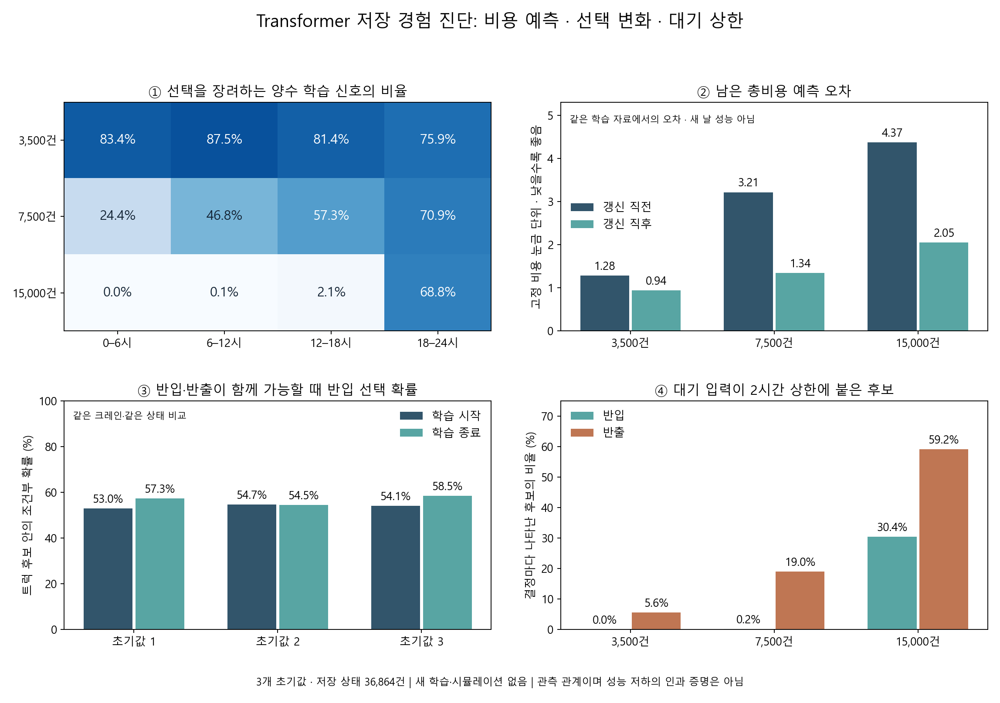

# 저장 경험에서 확인한 비용 예측·작업 선택·대기 상한

2026-11-17 · YR-332-ax(저장 경험 학습 신호 진단)

**우선 손볼 곳은 남은 비용을 예측하는 가치망이다.** 물량과 시각 차이가 행동 학습 신호에 크게 남아 있다.
다만 이 진단만으로 기존 성능 손실의 원인이 하나로 확정된 것은 아니다.
반입 선택 변화와 대기 입력 손실도 확인했으며, 학습의 확률 선택과 평가의 최고점 선택을 구분해야 한다.

## ① 진행사항

- 단순 신경망(MLP)·작업 관계를 읽는 Transformer 각각 초기값 3개, 갱신 6회의 **73,728개 저장 상태 전수**를 재계산했다.
- 기존 12개 학습 날짜 모양을 6모델이 경험한 자료다. 72개의 서로 다른 입력이나 73,728개의 독립 실험이 아니다.
- 원래 행동 확률·비용 목표·가치 예측을 재현하고, 동일 상태에서 갱신 직전/직후 및 최초/최종 순위를 비교했다.
- 36개 갱신의 첫 미니배치(한 번에 학습하던 표본 묶음)에서 행동·가치·탐색 기울기를 분리했다. 추가 학습은 없다.
- 입력·기존 코드·모델 **300파일 불변**, 목표 재계산 오차 0, 전체 행동 로그확률 최대 오차 `9.54e-7`.
  별도 방식의 72상태·288회 단독 예측 검사와 분석 정의 시험 6개를 통과했다.
- 최초 전체 집계 뒤, 공동 배정의 순서와 실제 한 크레인의 선택을 구분하는 보조 분석을 추가했다.
  같은 자료의 설명을 더한 사후 분석이며 사전 확증으로 부르지 않는다.

### 1. 바쁜 날의 어려움이 행동 평가에 남아 있다

학습 신호는 `실제 남은 비용의 음수 − 당시 가치 예측`을 두 날 자료 전체에서 표준화한 값이다.
양수면 원래 선택의 확률을 높이는 방향, 음수면 낮추는 방향의 신호다.
실제 갱신에는 확률 변화 제한과 다른 손실도 작용하므로 모든 선택 확률이 그 방향으로 움직이지는 않는다.

Transformer에서 양수 신호를 받은 결정 비율:

| 하루 물량 | 0–6시 | 6–12시 | 12–18시 | 18–24시 |
|---|---:|---:|---:|---:|
| 3,500건 | 83.4% | 87.5% | 81.4% | 75.9% |
| 7,500건 | 24.4% | 46.8% | 57.3% | 70.9% |
| 15,000건 | 0.0% | 0.1% | 2.1% | 68.8% |

15,000건의 정오 전 선택 5,838개 중 양수는 **6개뿐**이다. 초기값별로 0/1,926, 1/1,960, 5/1,952다.
단순 신경망도 같은 구간 5,930개 중 양수가 0개다. 어려운 시점의 선택을 세밀하게 구별하는 신호가 약하다는 경고다.
**이 선택들이 모두 잘못됐다는 뜻도, 음수 신호 자체가 강화학습 오류라는 뜻도 아니다.**

갱신별로 두 날을 6시간 구간 안에서 비교하면, 날별 평균 차이가 설명하는 신호 분산의 중앙값은
Transformer 84.0%, 단순 신경망 82.6%다. 시간 구간을 나누기 전에는 각각 49.0%, 24.9%다.
Transformer 범위는 구간을 나눈 뒤에도 1.4~92.6%라 모든 갱신이 같은 양상은 아니다.
이는 관측 자료의 분산 분해이며, 행동 효과와 날짜 효과를 인과적으로 분리한 추정치는 아니다.

### 2. 가치망은 배우지만, 다음 경험의 비용을 잘 맞추지 못한다

비용 예측 오차는 큰 오차에 더 무게를 주는 평균 오차(RMSE)다. 단위는 기존 고정 비용 눈금이며 실제 회계 손해가 아니다.

| 구조·하루 물량 | 갱신 직전 오차 | 같은 자료를 배운 직후 오차 |
|---|---:|---:|
| Transformer · 3,500 | 1.284 | 0.938 |
| Transformer · 7,500 | 3.214 | 1.343 |
| Transformer · 15,000 | 4.365 | 2.047 |
| 단순 신경망 · 전체 | 3.421 | 2.662 |
| Transformer · 전체 | 3.541 | 1.648 |

즉 주어진 자료를 맞추는 능력은 있으나, 다른 물량의 다음 날짜에 적용되는 기준 예측이 안정적이지 않다.
직후 수치는 학습 자료 적합도이며 새 날짜 검증 성능이 아니다. 자료 부족·정보 부족·학습 방식 중 원인은 아직 분리되지 않았다.
첫 미니배치의 가치 학습 기울기는 행동 기울기보다 중앙값 기준 단순 신경망 56.3배, Transformer 116.1배 컸다.
36개 갱신 각각의 첫 배치만 측정했다. 전체 학습의 기울기나 Adam 이후 실제 가중치 이동 비율로 읽으면 안 된다.
Transformer 공통 부분의 방향 충돌은 일부에만 있었고, 단순 신경망은 가치·행동망이 분리되어 있다.
따라서 **가치 기울기가 행동 학습을 망쳤다고 확정할 수는 없다.**

### 3. 반입 선호는 두 모델에서 강해졌다. 확률과 최고점은 구분해야 한다

아래는 같은 한 크레인에서 반입·반출이 모두 가능한 상태만 비교했다.
확률은 트럭 후보들 안에서 반입에 배분한 확률 합이다. 후보 수가 다르므로 50%를 공정성 기준으로 삼지 않는다.
최고점 비중은 해당 상태 중 반입 후보가 가장 높은 점수를 받은 비중이다.

| Transformer 초기값 | 상태 수 | 반입 확률 최초→최종 | 반입이 최고점인 상태 최초→최종 |
|---|---:|---:|---:|
| 9951101 | 5,919 | 53.03% → 57.29% | 3.45% → 98.85% |
| 9951102 | 6,054 | 54.73% → 54.50% | 88.34% → 80.69% |
| 9951103 | 5,863 | 54.09% → 58.51% | 6.14% → 95.74% |

두 초기값의 변화는 이전 평가의 반입 개선·반출 악화와 방향이 맞는다. **세 초기값 공통 원인으로 설명할 수는 없다.**
기록된 반입 선택의 평균 순위는 8.79→6.47위, 반출은 8.37→10.55위였다(전체 첫 자유 선택, 작을수록 앞).
후보 수가 다른 상태들의 평균이고 기록된 선택만 센 것이므로 작업 종류의 절대 우열로 읽지 않는다.

최종 확률 분포의 퍼짐은 균등 분포 대비 99.51~99.94%였다(정규화 엔트로피의 상태 평균).
각 후보에 주는 확률은 여전히 비슷하지만 최고점 후보는 크게 달라질 수 있다.
학습은 확률 추첨, 기존 평가는 최고점 선택이므로 작은 점수 차이가 평가 동작에서는 크게 드러난다.
이것은 PPO 구현 오류의 증거가 아니며, **다음 개선 비교에서 두 동작을 혼동하지 말아야 할 측정 사항**이다.

### 4. 대기 2시간 상한은 특히 혼잡한 날의 반출 정보를 많이 잃는다

Transformer 저장 상태의 첫 자유 선택에 나온 외부 트럭 후보 기준이다. 같은 작업이 여러 결정에 반복 등장할 수 있다.

| 하루 물량 | 상한에 붙은 전체 트럭 후보 | 반입 후보 중 | 반출 후보 중 | 상한 후보가 하나라도 있는 상태 |
|---|---:|---:|---:|---:|
| 3,500건 | 2.2% | 0.0% | 5.6% | 1.5% |
| 7,500건 | 10.1% | 0.2% | 19.0% | 10.0% |
| 15,000건 | 44.5% | 30.4% | 59.2% | 65.0% |

상한 정보 손실은 실제로 넓게 발생한다. 하지만 최종 모델이 긴 대기 후보를 일괄 회피한 것은 아니다.
상한/비상한 트럭이 함께 있는 상태의 상한 후보 확률 합은 세 초기값 모두 늘었다(42.99→43.62%, 40.79→42.73%, 43.27→44.11%).
그러므로 “상한 후보를 외면해서 반출이 악화됐다”는 단순 설명은 자료와 맞지 않는다.
저장 파일에는 2시간을 넘은 원래 대기가 없다. 2시간 이상을 같은 값으로 표현하는 한계는 확인됐지만 상한 제거 효과는 새 비교가 필요하다.

## ② 해석과 판정

- 가장 일관된 관측은 **남은 비용 예측이 물량·시각 차이를 충분히 제거하지 못한다**는 것이다.
  다음 수정 후보는 가치망 학습 안정화로 좁힌다. 총비용 목표·장기 영향 범위·정책 입력은 유지한다.
- 전체 비용을 짧은 시간창으로 자르거나, 상한 제거·신경망 확대·새 정보를 동시에 적용할 근거는 없다.
- 가치망은 정책 학습 신호의 흔들림을 줄이는 역할을 한다. 다만 좋은 예측이 반드시 좋은 정책을 보장하지는 않는다.
  근거: [GAE 원 논문](https://arxiv.org/abs/1506.02438), [PPO 원 논문](https://arxiv.org/abs/1707.06347).
- 가치 학습 목표만 정규화하고 원래 단위의 예측을 보존하는 PopArt가 비교 후보다.
  목표 비용을 자르는 방식과 구분한다. 항만 성능 개선은 미검증이다. [PopArt 원 논문](https://arxiv.org/abs/1602.07714).
- 이번 진단의 기록 검산은 통과했다. 기존 성능 미통과·운반 및 대기열의 현실성 미통과는 그대로다.
  새 학습이나 현장 성능 입증은 하지 않았다. 원래 자동 착수 거절과 사용자 요청 범위는 [기록](authorization.json)에 남겼다.

## ③ 예정사항

- **YR-332-ay(가치망 학습 안정화 한 축 비교)**: 남은 총비용의 기준 예측을 안정화하는 설정만 비교하도록 등록한다.
  왜: 세 초기값과 두 구조에서 큰 오차·날짜별 신호 차이가 반복됐다. 새로운 상태·짧은 보상창은 추가하지 않는다.
  이번에는 등록까지이며, 세부 설정 동결과 착수 판정 전에는 추가 학습을 하지 않는다.
- **YR-332-i/f(운반 흐름·대기열 실측 확인)**: 외부 자료가 필요하다. 합성 환경 결과를 실제 터미널 효과로 넓히기 위한 선결이다.

재현: `PYTHONPATH=src;scripts/v7`에서 `ppo_credit_audit.py run --kind <구조> --seed <초기값>`,
이어 `ppo_credit_summary.py`, `ppo_credit_choice_detail.py`. 최초 `prepare`는 기존 manifest 덮어쓰기를 금지한다.
계획·해시: [분석 계획](../../../docs/research/v7-discharge/ppo-credit-analysis-plan.md) · [입력 목록](manifest.json).
원값: [집계](summary.json) · [선택 보조 분석](choice-detail.json) · 구조별 `*.jsonl.gz` 6개.
검산: [전수·별도 방식](verification.json). 모든 수치는 기존 합성 학습 상태의 사후 기술 통계다.
