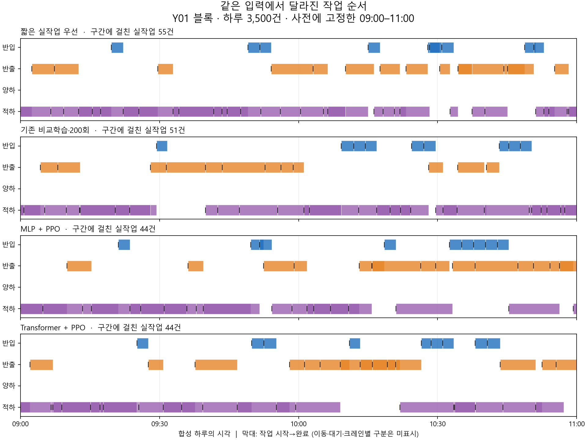

# ReSched 참고 Transformer+PPO 작업 순서 진단

## ① 진행사항

- 기존 미래 두 세계 비교 정답 대신, 실제 선택한 작업의 확률과 하루 비용으로 갱신하는 PPO를 연결했다.
- 비용은 기본60초 격자와 접수 등 추가 동기화 시각에서 기록한다. [기록 주기·규칙 정의 보충](../../../docs/research/v7-discharge/resched-ppo-clarifications.md).
- MLP(후보별 작은 신경망)와 Transformer(같은 블록 후보들이 정보를 주고받는 신경망)를 같은 조건으로 비교했다.
- 모델6개×합성12일·갱신6회, 새 합성3일에서54회 평가·2회 정확 재실행을 완료했다.
- 관련44검사, 기존 규칙 실행의 정확 재현, 두 구조의 첫 모델 각6회 갱신 가중치 재현을 확인했다.
  가중치 재현은 저장한 행동 표본의 optimizer 재실행이며, 학습 환경 전체를 다시 돌린 검사는 아니다.

| 방법 | 트럭 평균(분) | 규칙 대비 |
|---|---:|---:|
| MLP 학습 전 | 112.019 | +26.19% |
| MLP+PPO 학습 후 | 129.374 | +45.74% |
| Transformer 학습 전 | 131.837 | +48.51% |
| Transformer+PPO 학습 후 | 112.332 | +26.54% |
| 기존 누적자료200회 모델 | 92.377 | +4.06% |
| 짧은 실작업 우선 | 88.770 | +0.00% |
| 먼저 통지된 작업 우선 | 122.277 | +37.74% |
| 트럭 최장 대기 우선 | 121.605 | +36.99% |

+는 더 오래 걸림, −는 짧아짐이다. 각 입력의 오더 수로 가중한 평균이며 모델 초기값3개를 모두 포함한다.
코드명FIFO는 실제 블록 도착순이 아니라 공개 통지 시각순이다. 코드명LWKR는 남은 작업량이 아니라 트럭 누적 대기순이다.
트럭은 오더별 게이트 진입→작업 완료다. 24시간에 끝나지 않은 작업도 그때까지의 경과시간을 포함한다.
이 때문에 완료한 작업만의 평균이나 트럭 방문당 평균과 다르며, 미완료도 반드시 함께 본다.

| PPO 구조 | 학습 전후 시간 변화 | 계산상 비용 변화 | 모델별 시간 변화 범위 |
|---|---:|---:|---:|
| mlp | +15.49% | +17.08% | +5.05~+36.18% |
| transformer | -14.79% | -16.13% | -23.83~-3.10% |

### 학습 후 종류별 시간

| 작업 | 규칙(분) | MLP+PPO(분) | Transformer+PPO(분) | Transformer의 규칙 대비 |
|---|---:|---:|---:|---:|
| 반입 | 20.818 | 89.597 | 33.812 | +62.41% |
| 반출 | 144.014 | 161.713 | 176.167 | +22.33% |
| 양하 | 867.379 | 890.972 | 907.252 | +4.60% |
| 적하 | 813.733 | 919.891 | 905.024 | +11.22% |

본선은 스트림 계획 시작→개별 야드 작업 완료이며, 실제 배 한 척의 체류시간이 아니다.

| 물량 | 규칙 트럭(분) | MLP+PPO(분) | Transformer+PPO(분) |
|---:|---:|---:|---:|
| 3,500 | 15.407 | 18.083 | 15.039 |
| 7,500 | 27.268 | 28.700 | 24.390 |
| 15,000 | 136.640 | 205.679 | 179.005 |

### 미완료·계산 시간

| 방법 | 24시간 트럭 미완료/평가 오더 | 26시간 트럭 미완료 | 26시간 양하/적하 미완료 |
|---|---:|---:|---:|
| 짧은 실작업 우선 | 2600/26000 | 1593 | 2488/1751 |
| 기존 누적자료200회 모델 | 8055/78000 | 4987 | 8564/6472 |
| MLP+PPO 학습 후 | 14521/78000 | 11266 | 8136/8295 |
| Transformer+PPO 학습 후 | 12342/78000 | 9609 | 8448/7629 |

규칙은3회, 학습 모델은9회의 합계이므로 미완료 **건수만** 직접 비교하지 않는다. 분모와 같은 입력별 결과를 함께 본다.
아래 시간은 본 학습·병렬 평가 종료 후 3,500건을 한 번씩 다시 실행해 잰 후보 생성+정책 선택이다.

| 구조 | 중앙(밀리초) | 상위5% 경계(밀리초) | 최대(밀리초) | 실제 후보 최대/크레인 |
|---|---:|---:|---:|---:|
| mlp | 1.457 | 9.544 | 120.393 | 210 |
| transformer | 2.273 | 10.587 | 131.227 | 208 |

상위5% 경계는 결정100번 중 가장 느린5번에 들어가기 시작하는 시간이다. 적용·로그 시간은 제외한다.
최대 지연·동시 요청·실제 장비는 별도 검증해야 하며, 이 CPU 시험으로 현장 실시간 성능을 보장하지 않는다.
후보1,200개의 신경망 단독 계산은 [추론 측정](inference-benchmark.json)에 따로 보존한다.

### 학습량

| 구조/초기값 | 수집 결정 | 갱신 사용 표본 | optimizer 갱신 | 망 매개변수 |
|---|---:|---:|---:|---:|
| mlp/9951101 | 78,645 | 12,288 | 768 | 5,762 |
| mlp/9951102 | 78,616 | 12,288 | 768 | 5,762 |
| mlp/9951103 | 78,765 | 12,288 | 768 | 5,762 |
| transformer/9951101 | 78,885 | 12,288 | 768 | 43,810 |
| transformer/9951102 | 78,970 | 12,288 | 768 | 43,810 |
| transformer/9951103 | 78,750 | 12,288 | 768 | 43,810 |

매 갱신의 표본은 해당 시점 정책의 새 경험이다. 선택지가 없는 결정과 WAIT 순서만 다른 결정은 제외한다.
원논문의 대규모 학습보다 작은 진단이며, 원래 방식의 같은211쌍 반복 학습과도 다르다.

## ② 해석

- Transformer+PPO는 MLP+PPO보다 트럭 시간이 -13.17%, 규칙보다 +26.54%다.
- 계산상 비용은 Transformer가 규칙보다 +28.24%, MLP가 +49.06%다. 시간과 비용을 같은 지표로 취급하지 않는다.
- 이번 물량별 입력에서 Transformer는 규칙보다3,500건에서2.39%, 7,500건에서10.55% 짧았지만15,000건에서는31.00% 길었다. 전체 평균은 물량이 많은 입력의 영향을 크게 받는다.
- Transformer의 학습 전후 변화는 반입−58.07%, 반출+1.56%, 양하+1.96%, 적하−5.73%다. 평균 개선을 네 작업 모두의 개선으로 읽지 않는다.
- 두 새 모델 비교는 정보·행동·학습 예산이 같다. 저장 모델과는 자료량·학습법·결정 방식이 함께 달라 단일 원인을 분리하지 못한다.
- 같은 부모 생성기에서 나온3일이고 물량마다 한 곡선이다. 날짜 다양성·현장 개선·통계적 확증을 주장하지 않는다.
- 이전89.5분과는 평가 날짜가 다르다. 이번 같은 입력으로 재실행한 기존 모델 행과 비교해야 한다.
- 새 두 망은 매개변수 수·critic 공유 방식도 다르다. Attention 한 부품만의 효과를 분리한 실험은 아니다.
- 미래 비용은 하루 전체 결과라 한 작업의 영향이 작을 수 있다. 이 실행만으로 부족한 학습량·입력·보상 귀속 중 원인을 확정하지 않는다.
- 저장 표본으로 사후 측정한12개 첫 minibatch에서 전체 기울기 제한 배율은 0.0437~0.8172였다. 학습기에 넘기는 변경 방향 신호를 이 비율로 줄인다.
  Adam은 신호를 다시 조절하므로 실제 가중치 이동량이 같은 비율로 줄었다는 뜻은 아니다.
  가치 예측과 행동 선택의 기울기는 [내부 진단](gradient-diagnostic.json)에 분리했다. 일부 배치의 측정이며 원인을 확정하는 비교 실험은 아니다.
- ReSched의 두 갈래 표현을 참고한 적용이다. 공정 순서 RoPE·미래 공정 전체·블록 간 방문 그래프가 없고 원논문 재현이 아니다.
- 실제 터미널 전체에 적용하기 전 운반·대기열 정의 검증이 남아 있다. 기본 정책은 바꾸지 않았다.

## ③ 예정사항

- YR-332-i/f: 운반 장비 기록과 대기열 정의를 확인한다. 만든 환경이 실제 항만을 나타내는지 판단하기 위한 선행 자료다.
- YR-332-ax: 저장된 PPO 표본에서 물량·작업 종류별 행동 갱신과 비용 예측 오차를 확인한다. 혼잡 조건과 반출에서 남은 손실의 원인을 재학습 없이 좁히는 진단이다.
- YR-332-au: 저장된 기존 비교학습 모델의 점수와 공동 배정 연결을 읽기 전용으로 확인한다. 이전 방식의 원인을 이번 PPO 결과만으로 단정하지 않기 위함이다.
- YR-332-aw: 과거 보고서의 FIFO·LWKR 설명을 실제 코드 정의에 맞춰 정정한다. 계산 결과와 규칙 이름을 혼동하지 않기 위한 문서 확인이다.
- YR-323-e: 위 환경 조건을 확인한 뒤 미사용 기간 평가를 진행한다. 이번3일 개발 진단과 독립 검증을 구분하기 위한 작업이다.

고정 구간 작업 순서: [Y01·09:00~11:00 그림](schedule-window.png) · [원값](schedule-window.json).
그림은 한 블록의 고정2시간 예시다. 막대 수는 그 구간에 걸친 실작업 수이며 하루 처리량·성능 순위를 뜻하지 않는다.

근거: [원값 집계](summary.json) · [설정·코드 해시](campaign.json) · [사전등록](../../../docs/research/v7-discharge/resched-ppo-prereg.md).
[ReSched 논문](https://proceedings.iclr.cc/paper_files/paper/2026/file/467e109270678b3e2b3c2e7fa6b3d575-Paper-Conference.pdf), [공식 구현](https://github.com/XiangjieXiao/ReSched).
